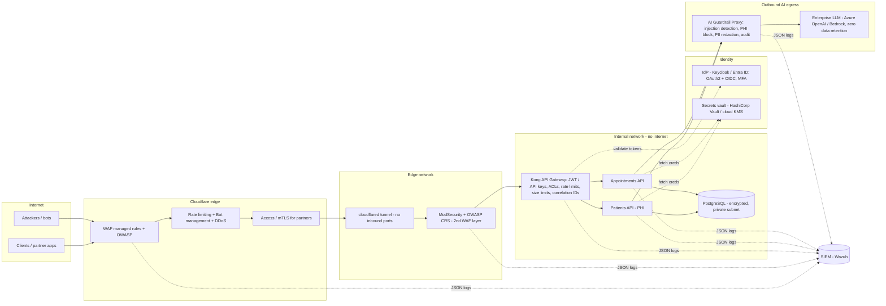

# Section 1A(a): architecture (draft, redraw it in your own diagram tool)

## Why each layer exists (be ready to defend these)
| Layer | Purpose | Key decision |
|---|---|---|
| Cloudflare edge | Absorbs DDoS, blocks known attacks and bots before they reach us | Origin only reachable through the tunnel, so the WAF can't be bypassed by hitting the server IP directly |
| ModSecurity + CRS | Second, self-hosted WAF close to the APIs | Defence in depth; full audit logs we control; works if the edge is misconfigured |
| Kong gateway | Single enforcement point for auth, rate limits, request size, routing | Admin API bound to localhost only; DB-less config kept in Git (reviewed and versioned) |
| APIs | Business logic | Strict schema validation, non-root containers, generic error messages |
| Database | Storage | Private network only, encryption at rest, least-privilege DB users per API |
| IdP | Who the caller is | OAuth2 client-credentials for services, OIDC + MFA for users; short-lived tokens |
| AI guardrail proxy | The only path to the LLM | Holds the LLM key (devs never see it); egress firewall blocks direct LLM access (stops Shadow AI) |
| SIEM | Detection and investigation | Every layer logs JSON with a shared `X-Request-ID` to trace one request end to end |

## Cloud mapping (if asked for a cloud preference)
| Component | AWS | Azure | Lab |
|---|---|---|---|
| Edge WAF | AWS WAF / Cloudflare | Front Door WAF / Cloudflare | Cloudflare |
| Gateway | API Gateway / Kong on EKS | API Management | Kong |
| Identity | Cognito / Entra ID | Entra ID | JWT (Keycloak optional) |
| Secrets | Secrets Manager + KMS | Key Vault | env vars (lab only) |
| LLM | Bedrock | Azure OpenAI | mock / any OpenAI-compatible |
| SIEM | Security Lake / Wazuh | Sentinel / Wazuh | Wazuh |
